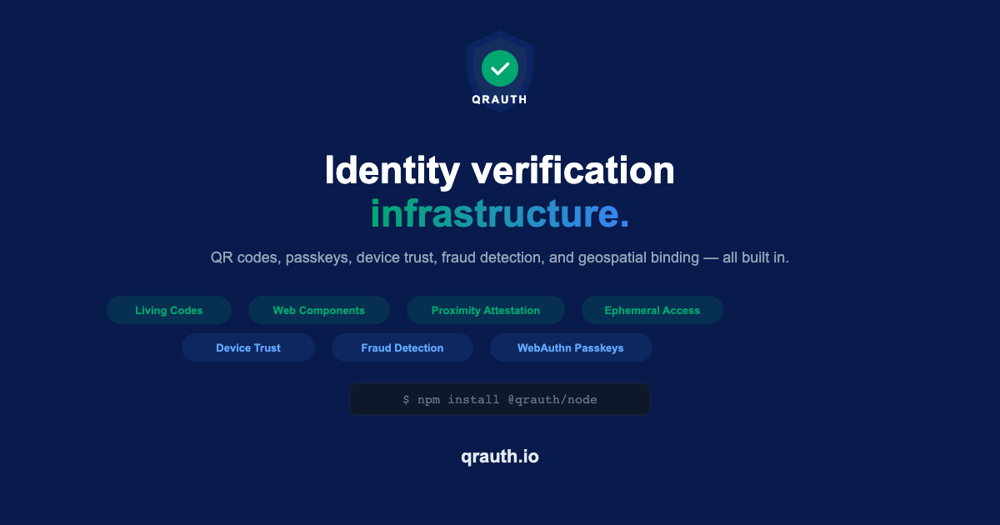
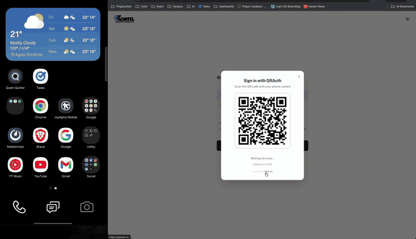

<p align="center">
  
</p>

<p align="center">
  <strong>Scan a QR with your phone, you're logged in.</strong><br />
  Drop-in passwordless sign-in with signed results. Source-available platform (BSL 1.1); SDKs and web components are MIT.
</p>

<p align="center">
  <a href="https://qrauth.io">Website</a> &middot;
  <a href="https://docs.qrauth.io">Docs</a> &middot;
  <a href="https://docs.qrauth.io/api/overview.html">API Reference</a> &middot;
  <a href="https://docs.qrauth.io/guide/oidc.html">OIDC</a> &middot;
  <a href="https://github.com/qrauth-io/qrauth/issues">Issues</a>
</p>

<p align="center">
  <a href="https://openid.net/certification/certified-openid-providers-profiles/">
    
  </a>
</p>

<p align="center">
  QRAuth is an <strong>OpenID Certified™</strong> OpenID Provider (Basic OP + Config OP profiles).
</p>

<p align="center">
  Organizations self-serve register OIDC clients from the dashboard (<strong>Sign-in Clients</strong>) — see the <a href="https://docs.qrauth.io/guide/oidc.html">OIDC guide</a>.
</p>

<p align="center">
  
</p>

---

## Drop it into any website

```html
<script src="https://cdn.qrauth.io/v1/components-0.4.3.js"
        integrity="sha384-hL0wjNsrF6Wwk8J5Jm0rkWvrYFzO9JBn4pvaH3xkm6wJzlE/5op/xqwKFbZKVVp2"
        crossorigin="anonymous"></script>
<qrauth-login tenant="your-app-id"></qrauth-login>
```

That's the whole integration. PKCE (S256), SSE updates, Shadow DOM encapsulated, SRI-pinned. [Full web component docs →](https://docs.qrauth.io/guide/web-components.html)

---

## Three ways to use QRAuth

1. **Passwordless login** — Scan a QR with your phone or tap a passkey. Like WhatsApp Web, for any site. Zero password, zero app install.
2. **QR fraud protection** — Signed QR codes with a registered location and a hash-chained issuance log. A scan shows whether the code was issued by the claimed organization.
3. **Ephemeral delegated access** — Time-limited QR sessions without consumer accounts, optionally bound to a device fingerprint.

## Trust model

- **Passkeys** — Native WebAuthn/FIDO2. Passkeys and QR approval share one identity.
- **Hybrid signatures** — Every new code is signed with ECDSA-P256 over a domain-separated canonical payload, and its Merkle batch root is signed with SLH-DSA-SHA2-128s (FIPS 205). QRAuth verifies both on every scan.
- **Issuance log** — Every issuance is appended to a hash-chained issuance log.
- **MIT license** — `@qrauth/animated-qr`, `@qrauth/web-components`, `@qrauth/node` and `@qrauth/cli` are MIT. Fork them.

---

## Table of Contents

- [How QRAuth Compares](#how-qrauth-compares)
- [Problem](#problem)
- [Solution](#solution)
- [Quick Start](#quick-start)
- [SDKs](#sdks)
- [Architecture](#architecture)
- [Animated QR — Living Codes](#animated-qr--living-codes)
- [Ephemeral Delegated Access](#ephemeral-delegated-access)
- [Proximity Verification API](#proximity-verification-api)
- [Web Components](#web-components)
- [Security Model](#security-model)
- [Status](#status)

---

## How QRAuth Compares

| Capability | QRAuth | Passkeys Only | Auth0 / Clerk | TOTP / 2FA | Magic Links |
|---|---|---|---|---|---|
| Passwordless | Yes | Yes | Optional | No | Yes |
| Cross-device auth (desktop via phone) | Yes (QR) | Limited | No | No | No |
| WebAuthn/FIDO2 passkeys | Yes (built-in) | Yes | Plugin | No | No |
| Device trust registry | Yes (NEW/TRUSTED/SUSPICIOUS) | No | No | No | No |
| Fraud detection engine | Rule-based signals | No | Basic | No | No |
| Geospatial binding | Yes (PostGIS) | No | No | No | No |
| Physical QR verification | Yes | No | No | No | No |
| Proximity attestation (signed JWT) | Yes | No | No | No | No |
| Issuance log | Yes (hash-chained) | No | No | No | No |
| Works on kiosks/smart TVs | Yes | No | No | No | No |

QRAuth and passkeys are complementary. Use passkeys for platform-native flows and QR auth for cross-device, kiosk, and physical scenarios. Both are unified under one identity.

---

## Problem

QR code fraud is a global epidemic. Scammers print fake QR stickers and paste them over legitimate ones on parking meters, government signs, and payment terminals. Victims scan, land on a convincing phishing site, and enter payment credentials. Nothing built into a QR code tells the scanner it came from the claimed issuer.

Recent examples include 29 compromised parking pay stations in Austin, TX, INTERPOL Operation Red Card 2.0 arrests across 16 nations (February 2026), and an arrest in Thessaloniki for swapping metal parking signs with plastic replacements carrying fraudulent QR codes (March 2026).

QRAuth was built to close that gap — then the same primitive turned out to be a clean solution for passwordless auth, which is the use case this README leads with.

---

## Solution

QRAuth is **infrastructure, not an app**. The signing and verification layer lives behind an SDK; any application can embed it in a few lines.

```
┌──────────────────────────────────────────────────────────────────┐
│                     Applications (Your Products)                 │
│                                                                  │
│  Login Pages    Payment App    Event Platform    Parking POS     │
│      │              │               │                │           │
│      └──────────────┴───────────────┴────────────────┘           │
│                             │                                    │
│                  @qrauth/node or web component                   │
│                             │                                    │
├─────────────────────────────┼────────────────────────────────────┤
│                      QRAuth Platform                             │
│                                                                  │
│   Signing Engine ─── Verification API ──── Geo Registry          │
│   Fraud Detection ── WebAuthn Service ─── Event/Webhook Bus      │
│   Issuance Log ───── Tenant Management ── Analytics Pipeline     │
│                                                                  │
└──────────────────────────────────────────────────────────────────┘
```

Signed QRs resolve to a short verification URL. Any phone camera opens it; the QRAuth API verifies the signatures, compares the scanner's reported location, and returns issuer identity plus a per-request visual proof. Each recorded scan sends a `qr.scanned` webhook to your app.

---

## Quick Start

### Passwordless login — web component + server verify

Drop the component into any page:

```html
<script src="https://cdn.qrauth.io/v1/components-0.4.3.js"
        integrity="sha384-hL0wjNsrF6Wwk8J5Jm0rkWvrYFzO9JBn4pvaH3xkm6wJzlE/5op/xqwKFbZKVVp2"
        crossorigin="anonymous"></script>
<qrauth-login tenant="your-app-id"></qrauth-login>
```

Listen for `qrauth:authenticated` in the browser; on the backend, verify the signed result before issuing your own session:

```typescript
import { QRAuth } from '@qrauth/node';

const qrauth = new QRAuth({
  clientId: process.env.QRAUTH_CLIENT_ID,
  clientSecret: process.env.QRAUTH_CLIENT_SECRET,
});

// In your callback handler, after the browser SDK fires onSuccess:
const result = await qrauth.verifyAuthResult(sessionId, signature);
if (result.valid) {
  issueSessionFor(result.session.user);
}
```

### Signed QR for fraud protection

```typescript
const qr = await qrauth.create({
  destination: 'https://parking.thessaloniki.gr/pay/zone-b',
  location: { lat: 40.6321, lng: 22.9414, radius: 15 },
  expiresIn: '1y',
});
// qr.verificationUrl → https://qrauth.io/v/<token>
```

Any phone camera opens the verification URL; QRAuth returns issuer, location match, and a trust score. Full examples: [quickstart guide →](https://docs.qrauth.io/guide/quickstart.html).

---

## SDKs

| SDK | Package | Status |
|---|---|---|
| Node.js / TypeScript | `@qrauth/node` | Stable |
| Python | `qrauth` (PyPI) | Deprecated 2026-04-16 — removed from CI, archived |
| Web Components | `@qrauth/web-components` | Stable (MIT) |
| Animated QR | `@qrauth/animated-qr` | Stable (MIT) |
| Go, PHP, Swift, Kotlin, React | — | Planned |

The Node SDK provides `create`, `verify`, `revoke`, `list`, `get` and bulk methods, plus ephemeral-session and proximity methods. Auth-session methods (`createAuthSession`, `getAuthSession`, `verifyAuthResult`) are available where client credentials are configured.

---

## Architecture

Fastify API gateway (Node 22) fronts a Postgres + PostGIS store and Redis (cache + streams + rate limits). QR signatures are hybrid: ECDSA-P256 per code plus an SLH-DSA-SHA2-128s (FIPS 205) signature over each Merkle batch root, and verification requires both. Other signed artefacts (proximity attestations, auth-session approvals, OIDC ID tokens) use classical ECDSA or RSA only. Background workers handle fraud analysis, webhook delivery, alerts, cleanup, and signing-key rotation.

Deeper dives: [signing architecture](https://docs.qrauth.io/guide/signing-architecture.html), [protocol design](https://docs.qrauth.io/guide/protocol-design.html), [threat model](https://docs.qrauth.io/guide/threat-model.html).

---

## Animated QR — Living Codes

Animated QR codes that rotate frames on a configurable interval (1000 ms by default), each frame carrying an HMAC-SHA-256 tag. The frame-verify endpoint (`POST /api/v1/animated-qr/validate`) accepts a frame whose timestamp is at most 5 s old and at most 2 s in the future, and requires a strictly increasing frame index per session.

<p align="center">
  
  <br />
  <em>Living Code rotating frames, each carrying an HMAC-SHA-256 tag</em>
</p>

Dual-engine renderer (Canvas 2D at ~15 KB gzipped, CanvasKit/Skia WASM lazy-loaded for GPU paths), trust-reactive visual states (calm → warning → distortion → dissolve), and a benchmark harness.

Package: `@qrauth/animated-qr` (MIT). [Full guide →](https://docs.qrauth.io/guide/living-codes.html) · [Live demo →](https://qrauth.io/demo/qranimation)

---

## Ephemeral Delegated Access

Time-limited, scope-constrained sessions that require no account creation. A developer generates a QR with embedded permissions and TTL; a guest scans, gets a scoped session, and the session auto-expires. No credentials, no signup, no consumer-side schema changes.

```typescript
const session = await qrauth.createEphemeralSession({
  scopes: ['read:menu', 'write:order'],
  ttl: '30m',
  maxUses: 1,
  deviceBinding: true,
});
```

Typical uses: hotel-room controls, restaurant ordering scoped to a table, time-boxed contractor access, event day-passes. [Full guide →](https://docs.qrauth.io/guide/ephemeral.html)

---

## Proximity Verification API

A proximity attestation states that the device reported a location within Y metres of the QR code's registered location at time T, signed by the issuing organization. The location is reported by the client; the attestation is not proof of physical presence. Attestations are JWT-shaped (`alg: ES256`, 5-minute TTL) and are verified with `POST /api/v1/proximity/verify` (`verifyProximityAttestation` in `@qrauth/node`).

```typescript
const attestation = await qrauth.getProximityAttestation(scanToken, {
  clientLat: 40.6325,
  clientLng: 22.9410,
  rpId: 'example.com',
  deviceFingerprint: '<device identifier>',
});
// claims: { iss, sub, aud, device, loc, proximity: { matched, distanceM, radiusM }, alg_version, iat, exp }
```

Useful as a signed record of a scan near a registered location. Location comes from the scanning device, so pair it with other controls for high-value decisions. [Full guide →](https://docs.qrauth.io/guide/proximity.html)

---

## Web Components

The primary integration surface. Framework-agnostic custom elements, Shadow-DOM encapsulated, shipped via the SRI-pinned CDN URL. Theming via CSS custom properties (`--qrauth-primary`, `--qrauth-bg`, …). Events bubble and cross shadow boundaries.

```html
<!-- Passwordless login -->
<qrauth-login tenant="your-app-id" theme="dark" scopes="identity email"></qrauth-login>

<!-- Second-factor on top of existing auth -->
<qrauth-2fa tenant="your-app-id" session-token="existing-session-token"></qrauth-2fa>

<!-- Ephemeral delegated access -->
<qrauth-ephemeral tenant="your-app-id" scopes="read:menu" ttl="30m" max-uses="1"></qrauth-ephemeral>
```

Events: `qrauth:authenticated`, `qrauth:verified`, `qrauth:claimed`, `qrauth:scanned`, `qrauth:expired`, `qrauth:denied`, `qrauth:error`.

Delivery:

- **CDN (pinned, recommended):** `https://cdn.qrauth.io/v1/components-0.4.3.js` — 1-year immutable + SRI-pinnable. Current versions and SRI hashes at `https://cdn.qrauth.io/v1/latest.json`.
- **CDN (rolling):** `https://cdn.qrauth.io/v1/components.js` — short TTL, no SRI.
- **npm:** `@qrauth/web-components` (20.8 KB gzipped, 0.4.3).

[Full guide →](https://docs.qrauth.io/guide/web-components.html)

---

## Security Model

Five layers, all active automatically from the user's perspective:

1. **Signed QR (baseline)** — ECDSA-P256 over the domain-separated canonical payload (algorithm version, token, tenant, destination hash, geo hash, expiry). Rejects codes not issued by the claimed organization.
2. **Ephemeral visual proof** — The verification page shows the request's approximate city, browser and OS, a timestamp, and a short keyed-hash fingerprint over those values, so a static copy of the page cannot show current values.
3. **Fraud signals** — Duplicate location, geo-impossibility, scan velocity, bot user agent and device clustering create fraud incidents that lower the trust score. The verification page also warns when it is served from a non-QRAuth hostname.
4. **WebAuthn passkeys** — Bound to the `qrauth.io` origin, so a passkey cannot be used on a look-alike domain.
5. **Post-quantum hybrid** — Each QR is signed individually with ECDSA-P256; batch Merkle roots are signed with SLH-DSA-SHA2-128s (FIPS 205), so the per-QR post-quantum cost is amortized across a Merkle batch. Every verification runs ECDSA-P256, a Merkle inclusion proof and the SLH-DSA-SHA2-128s batch-root check (cached per batch). An HMAC-SHA3-256 MAC pre-filter runs first and can only reject. Measured full hybrid verify with a warm batch cache: P50 ~0.15 ms, P95 ~0.18 ms. Every issuance is appended to a hash-chained issuance log.

[Algorithm specification →](ALGORITHM.md) · [Threat model →](THREAT_MODEL.md) · [Full security model →](https://docs.qrauth.io/guide/security.html)

---

## Status

QRAuth is in active development. The core platform, SDKs, and all major subsystems are shipped and running in production at [qrauth.io](https://qrauth.io).

**Shipped:** hybrid ECDSA-P256 + SLH-DSA (FIPS 205) QR signing with Merkle batch architecture, WebAuthn PQC bridge (ML-DSA-44, FIPS 204), hash-chained issuance log, HMAC-SHA3-256 MAC pre-filter, separate signer service on a private network, PQC health dashboard, canonical test vectors, WebAuthn passkeys, device trust registry, rule-based fraud detection, Living Codes (animated QR), ephemeral delegated access, proximity attestation, web components, Node.js SDK, multi-tenant dashboard, background workers.

See [GitHub releases](https://github.com/qrauth-io/qrauth/releases) for release history.

---

## More docs

- [QRVA Open Protocol](https://docs.qrauth.io/guide/protocol.html)
- [Authentication flows](https://docs.qrauth.io/guide/authentication.html)
- [Device trust](https://docs.qrauth.io/guide/device-trust.html)
- [Fraud detection](https://docs.qrauth.io/guide/fraud-detection.html)
- [Trust levels](https://docs.qrauth.io/guide/trust-levels.html)
- [Trust Reveal UX](https://docs.qrauth.io/guide/trust-reveal.html)
- [Compliance](https://docs.qrauth.io/guide/compliance.html)
- [API reference](https://docs.qrauth.io/api/overview.html)

---

## Roadmap

<details>
<summary>View full roadmap — Phase 0–2 shipped, Phase 3 in progress</summary>

**Phase 0 — Minimum Credible Launch** (shipped): Node.js SDK, OpenAPI spec, React dashboard, API-key self-service.

**Phase 1 — Developer Experience** (shipped): webhook delivery (HMAC-signed, retry), usage metering + plan enforcement, quickstart guide, onboarding flow.

**Phase 2 — Platform Maturity** (shipped): QRVA protocol specification, Stripe billing + pricing page, dashboard analytics, Python SDK (since deprecated, 2026-04-16).

**Phase 3 — Scale & Differentiation** (in progress): additional SDKs (Go, PHP, Swift, Kotlin), WebAuthn passkey verification UX, custom domains.

**Post-Quantum Migration Track** (parallel):

- [x] PQC-0 — SHA3-256, single entropy helper over the OS CSPRNG, algorithm agility, canonical test vectors
- [x] PQC-1 — Merkle batch architecture, SLH-DSA root signing, WebAuthn PQC bridge, PQC health dashboard
- [ ] PQC-2 — SDK warnings and webhook v2 payloads (shipped), ECDSA sunset announcements
- [ ] PQC-3 — QRVA v3 protocol, PQC WebAuthn credentials, FIPS 140-3 submission


</details>

---

## Contributing

Bug reports, feature requests, new-language SDKs, and fixes are all welcome. See [CONTRIBUTING.md](CONTRIBUTING.md) for setup, code standards, and PR flow. Good first issues: [`good first issue`](https://github.com/qrauth-io/qrauth/labels/good%20first%20issue).

---

## License

The platform is licensed under the Business Source License 1.1 ([LICENSE](LICENSE)) with these parameters:

- Licensor: QRAuth
- Licensed Work: QRAuth Platform
- Change Date: Four years from each release date
- Change License: Apache License 2.0

The main restriction (Terms, condition 1): "You may not provide the Licensed Work to third parties as a Software-as-a-Service (SaaS), cloud service, or similar service for generating revenue." See [LICENSE](LICENSE) for the full terms.

`@qrauth/animated-qr`, `@qrauth/web-components`, `@qrauth/node` and `@qrauth/cli` are MIT. The QRVA protocol specification ([qrauth-io/protocol](https://github.com/qrauth-io/protocol)) is CC BY 4.0.

---

*Passwordless authentication and cryptographic verification for every QR code on the web.*
